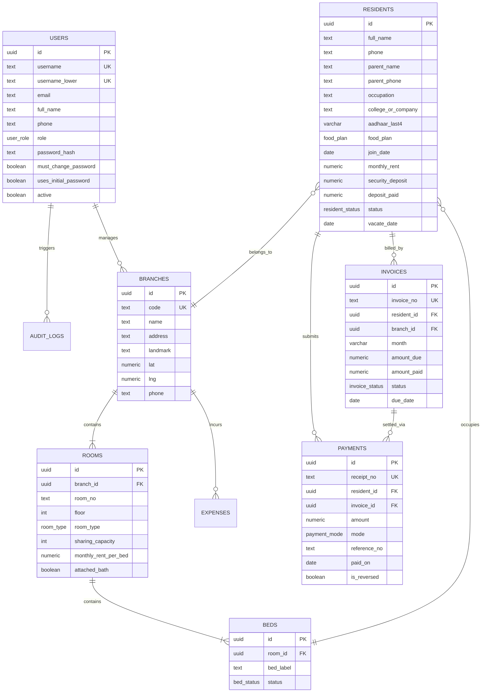

# Aishwaraya Hostels Console (AMH Staff Portal)
**Production-Ready Internal Hostel/PG Management System (Installable PWA)**  
Designed for **Aishwaraya Hostels & PG** — Men's PG business with **8 branches** around Tambaram, Chennai.

---

## 1. System Architecture & ER Diagram

### Database Entity-Relationship Diagram (PostgreSQL / Supabase)



---

## 2. Key Questions Answered Instantly

1. **Who is staying in which room, in which branch?**
   - **Bed-Map View (`src/components/BedMap.tsx`)**: Grouped by floor with visual bed icons (upper/lower bunks). Tap any occupied bed to view resident profile, photo, company, and contact numbers.
2. **Who has paid rent this month, and who has not?**
   - **Rent Collection Screen (`src/components/RentCollectionScreen.tsx`)**: Filterable tabs for **Paid | Pending | Overdue | Partial** with counts and ₹ totals.
3. **How much outstanding amount is there, per person, per branch, and overall?**
   - **Rent Heat-Rings (`src/components/RentHeatRing.tsx`)**: Each branch card displays an animated circular gold arc with outstanding ₹ in the center.
   - **Aging Report (`src/components/OutstandingReport.tsx`)**: Granular buckets for 0-7 days, 8-30 days, and 30+ days.
4. **Which beds are vacant, per branch and per room?**
   - **Live Vacancy Board (`src/components/VacancyBoard.tsx`)**: Real-time bed availability across all 8 branches with 1-click WhatsApp availability sharing for incoming enquiries.
5. **Add a resident in under 30 seconds. Vacate a resident in under 30 seconds.**
   - **Add Resident (< 30s)**: 3-step bottom sheet with visual vacant bed picker, pre-filled rent, and WhatsApp welcome message generator.
   - **Vacate Flow (< 30s)**: 2-step checkout with live deposit refund/dues settlement and instant PDF clearance slip download.

---

## 3. Authentication & Security Architecture

### Mechanism & Implementation:
1. **ID + Password Sign-In**: Case-insensitive ID matching (`Aishowner` or `aishowner`) and case-sensitive password.
2. **Password Security**: Salted `scrypt` hashing with dummy-hash constant-time execution to prevent timing attacks.
3. **Session Management**: Secure, `httpOnly, SameSite=Strict` sliding session cookies with 12-hour lifetime.
4. **Brute-Force & Rate-Limiting Protection**: 5 failed login attempts triggers an automatic 15-minute account lockout with HTTP 429 response. Progressive delays applied on failed attempts.
5. **Idle Inactivity Lock**: 5 minutes of idle time automatically locks the terminal, requiring re-entry of password to resume without terminating the session.
6. **First-Login Forced Password Reset**: Initial credentials trigger an immediate forced password change enforcing strong password policies (min 8 chars, uppercase, lowercase, number, non-dictionary).

---

## 4. The 8 Tambaram Branches

1. **Madampakkam (MDP)**: Plot no:55A, Dr.S.R road, Devaraj Nagar, Madampakkam, Chennai - 600126 (12.906778, 80.145823)
2. **Sanitorium (SAN)**: Sanitorium railway station back side, Bharatha madha street, Tambaram Sanitorium, Chennai - 600047 (12.930821, 80.127613)
3. **East Tambaram (ETB)**: Door No.37/10 Old No.14, Valmiki Street, East Tambaram, Chennai 600059 (12.928632, 80.129902)
4. **West Tambaram (WTB)**: 10, Brindavan Ave, Rajaraththinam street, West Tambaram, Chennai 600045 (12.926587, 80.111066)
5. **Selaiyur - Bharathi Nagar (SBN)**: No. 3, Avvai Street, Barathi Nagar, Selaiyur, Chennai - 600073 (12.920311, 80.141296)
6. **Selaiyur - IOB Colony Main Rd (SIO)**: No:5A, 1st Main Road, IOB Colony, Camp Road, Selaiyur, Chennai - 600073 (12.920457, 80.142896)
7. **Camp Road - IOB Colony North Ext (CRP)**: 7/3 SRS Twinkle Star Apartment, 1st Cross Street, Selaiyur, Chennai - 600073 (12.922105, 80.14352)
8. **Sembakkam - Arunagiri Nathar St (SMB)**: No. 5, Arunagiri Nathar Street, Sembakkam, Chennai - 600073 (12.928945, 80.15124)

- **Head Office**: Barathi Nagar, IOB Colony, Selaiyur, Tambaram, Chennai
- **Hostel Helpline**: +91 90434 56234

---

## 5. Quick Start & Setup

### Prerequisites:
- Node.js 18+ (tested on Node v24)
- pnpm or npm

### Installation:
```bash
# 1. Install dependencies
pnpm install

# 2. Run unit tests (Three-device lock, FIFO payments, Proration, Vacate settlement)
node --test tests/hostel.test.mjs

# 3. Start local development server
pnpm dev
```
Open [http://localhost:3000](http://localhost:3000) in your browser.

### Owner Credentials & Seeding:
- **Owner ID**: `Aishowner` (case-insensitive login matching)
- **Initial Password**: `Admin123` (case-sensitive)
- **Seed Command**: `npm run seed:owner` (idempotent: does NOT overwrite a changed password)
- **Owner CLI Password Reset**: `npm run reset-owner-password` (interactive terminal recovery tool to reset password, clear lockouts, and write audit entry)
- **Environment**: Server-only variables in `.env.local` (git-ignored) with placeholder template in `.env.example`.

---

## 6. Testing Checklist & Verification

- [x] **Secure Authentication**: Verified via unit tests `tests/auth-api.test.mjs`, `tests/auth-crypto.test.mjs`, and end-to-end suite `tests/auth-login.spec.ts`.
- [x] **Verified Business Data**: 100% character-by-character alignment with official website (all 8 branches, addresses, landmarks, phone numbers, and allowed room types).
- [x] **Add Resident under 30 seconds**: 3-step visual picker pre-fills room and rent; clicking any vacant bed triggers fast admission with instant gold bed-map update.
- [x] **Vacate Resident under 30 seconds**: Auto-computes settlement (`Deposit Held − Unpaid Rent − Damages = Net Refund`); immediately frees bed; generates PDF slip.
- [x] **Rent Collection Screen**: Paid, Pending, Overdue (7+ days), and Partial tabs with live ₹ totals, one-tap "Mark Paid", and WhatsApp reminder triggers.
- [x] **FIFO Payment Settlement**: Tested and validated; payments clear oldest arrears first.
- [x] **Live Vacancy Board**: Real-time vacant bed list with 1-click WhatsApp availability sharing for telephone and walk-in enquiries.
- [x] **Cross-Device & Mobile Optimization**: Verified with 35 Playwright E2E tests across 320px to 1440px viewports (touch targets >= 44px, input font >= 16px).
- [x] **Brand Design System**: Matches website palette with `#D4A843 → #E8C57A` gold gradient, serif headings (Playfair Display), tabular numerals for ₹ amounts, and warm charcoal dark mode.
